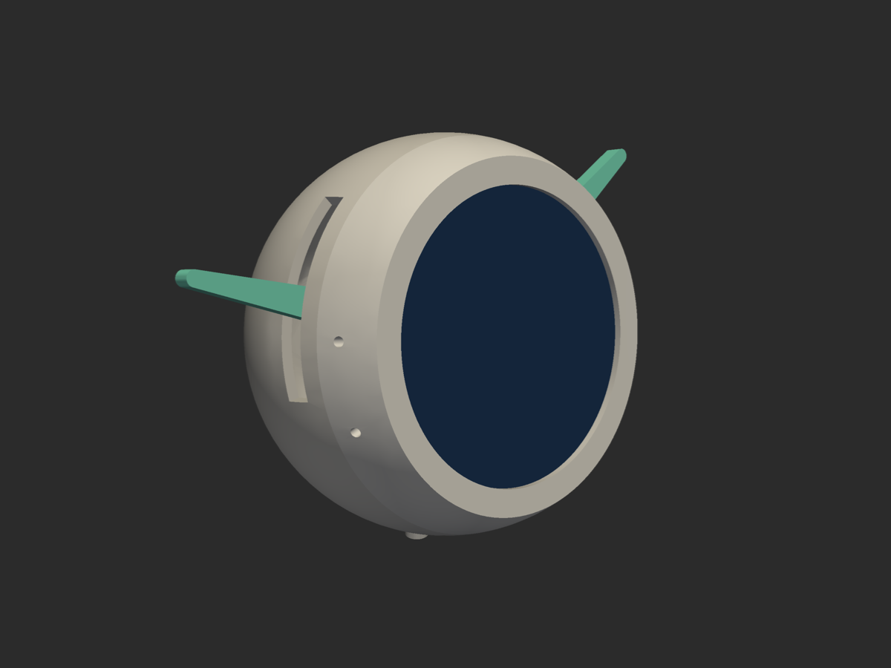

# Sultana body (parametric CAD)

A [build123d](https://github.com/gumyr/build123d) model of Sultana's body,
built around the Waveshare ESP32-S3-Touch-LCD-1.85 (1.85" round 360×360 display
with an ESP32-S3 on its back) and an X27.168 gauge stepper for the arms.
Everything is driven by the `Params` dataclass at the top of
[`sultana_body.py`](sultana_body.py).



## Run it

```bash
cd cad
uv venv --python 3.12 .venv
uv pip install --python .venv/bin/python build123d pyvista
```

```bash
.venv/bin/python sultana_body.py --render
```

That builds every part, runs the checks, writes STLs and a STEP assembly to
`out/`, and renders PNGs to `renders/`. A full run takes about two minutes, most
of it in the checks. `--quick` skips the checks.

The STEP assembly has every part in it, named: the printed parts, the bought
parts as placeholders, and every screw, magnet and the bearing.

## Assembly viewer

```bash
.venv/bin/python sultana_body.py --serve
```

That exports as usual, then serves the viewer at http://127.0.0.1:8765/viewer/.
It steps through the assembly one operation at a time, with each part sliding
in along the direction it actually goes in. You get:

- **Steps:** arrow keys or the buttons step through; click a step to play it.
- **Explode:** a slider that pulls everything apart along its assembly direction.
- **See-through shells**, and a **section** plane along X, Y or Z with a slider.
- **Parts list:** every part by name, with a checkbox to hide it. Click a part,
  in the list or the 3D view, to see its name and the step it goes in at.

The viewer loads three.js from a CDN, so it needs a network connection. It
reads `out/viewer/`, which every export rewrites, so after changing a parameter
re-export and reload.

Override any parameter on the command line:

```bash
.venv/bin/python sultana_body.py --set sphere_d=70 face_tilt_deg=12 arm_len=48 arm_tip_w=2
```

`--list` prints every parameter with its current value. `--min-sphere` finds the
smallest `sphere_d` at which everything still fits with the other parameters as
given.

The STEP file opens in Fusion 360 as plain solids, one component per part,
including the bought parts as placeholders. Fusion can't drive the parameters;
change them here and re-import.

## What you can change

The ones you'll most likely want:

| Parameter | What it does |
|---|---|
| `sphere_d` | Body diameter. Everything else follows. |
| `wall` | Shell wall thickness. |
| `face_tilt_deg` | How far the face looks up when the robot sits on a table. |
| `face_window_d`, `face_lip`, `face_rim_extra` | Visible opening, how much shell covers the glass edge, extra flat ring around the face. |
| `arm_rest_deg` | Arm angle above horizontal at offset 0. |
| `arm_travel_deg` | Range of offsets the slots and checks cover. The firmware should clamp to the same range. |
| `arm_len`, `arm_root_w`, `arm_tip_w`, `arm_t` | Visible arm length, taper (width at the root and tip, as seen from the front), and front-to-back depth. |
| `arm_curve_deg` | Bend the arm upward along its length. |
| `bottom_flat_d`, `back_flat_d` | The flat it sits on, and the flat that carries the USB-C port. |
| `speaker_mode`, `speaker_size`, `speaker_round` | `"bottom"` (fires down through the LED ring), `"back"` or `"none"`; size as w, d, h (a round speaker uses w as its diameter). |
| `port` | `"pd"` (Adafruit HUSB238 board) or `"fpc"` (a plain USB-C extension socket). |
| `gear_module`, `gear_teeth`, `pivot_z` | Gear size and pivot height; pivot spacing is module × teeth. |
| `snap_angles`, `snap_t`, `snap_len`, `snap_engage`, `snap_hold_deg` | Where the catches sit, how stiff they are, how far they hook, and how hard they hold. |
| `lock_angles`, `lock_twist_deg`, `lock_draw`, `lug_bearing` | The display module's twist-lock: where the legs sit, how far it turns, how much the ramp pulls it in, and how much the lugs grip. |

The rest (clearances, magnets, post positions, bought-part sizes) are in
`Params` with a comment each.

## Checks

Every run prints a JSON report (also saved as `out/report.json`):

- **interference_mm3**: overlapping parts, including the bought-part placeholders.
- **arm_travel**: the gears and arms rotated to both ends of `arm_travel_deg`, against everything else.
- **back_shell_slide_on**: whether the back shell can slide on from behind without hitting anything inside.
- **display_module_in**: the display module (board, USB plug, front carrier and its screws), turned to the twist-lock's start angle, pushed into the bezel from behind and then turned home, checked against the bezel at each step.
- **torque**: mass, centre of mass and inertia of each gear + arm from the actual geometry, the torque the X27 needs (gravity at the worst angle plus inertia at `accel_limit_dps2`), and the margin against the X27 datasheet.

A clean run reports `none`, `clear`, `clear`, `clear`.

The overlap check only looks at parts where they end up. The two path checks
cover the moves that need room on the way in. Anything else that has to pass
something during assembly isn't checked, so step through the viewer for that.

## Parts

Printed (STLs in `out/`): `bezel`, `back_shell`, `carrier_front`,
`carrier_back`, `motor_strap`, `gear_left`, `gear_right`, `arm_left`,
`arm_right`.

Bought:

- Waveshare ESP32-S3-Touch-LCD-1.85
- X27.168 gauge stepper (the `.168` has the internal end stop the firmware homes against)
- VID6606 stepper driver on an SOP-28 to DIP adapter, with 2 × 100 nF and 22 µF
- Adafruit USB Type C Power Delivery Dummy, I2C or Switchable (HUSB238, ADA5991), switches set to 5 V; skip its terminal block
- Short right-angle USB-C plug pigtail (USB 2.0 data + power) into the Waveshare board
- 8 × WS2812B ring, 32 mm OD (e.g. https://www.amazon.co.uk/dp/B0BPN2DFL5)
- 1N4001 (or any silicon diode) for the LED ring's supply, see wiring
- 470–1000 µF / 6.3 V capacitor on the 5 V rail
- Speaker: Adafruit 1890 mini metal speaker (28 mm × 4.5 mm, 8 Ω, 0.25 W
  rated, 0.5 W max, wire leads); for a different one, set `speaker_size`. The
  board's amplifier can push about 1.3 W, several times what this speaker takes:
  turn the board's volume trimmer well down and cap the volume in firmware
- MR105ZZ ball bearing (5 × 10 × 4 mm, metal shields rather than rubber seals,
  which drag) for the right gear; set `bearing=false` to use a plain printed pin
- M2 screws: 3 × M2×4 machine screws into the board's brass standoffs; 3 × M2×5
  self-tapping into the carrier posts

## Wiring

Power and data come in through one USB-C port on the back:

```
Mac ── USB-C ── HUSB238 board (negotiates 5 V / 3 A)
                 ├─ 5 V + GND ─┬─ 1000 µF
                 │             ├─ VID6606 VDD
                 │             ├─ diode ── LED ring 5 V
                 │             └─ USB-C plug VBUS/GND ──┐
                 └─ D+ / D- ─────── USB-C plug D+/D- ───┴── Waveshare board USB-C
```

| ESP32-S3 pin | Where | Use |
|---|---|---|
| GPIO44 | UART header RXD | VID6606 f(scx) (step); quiet during boot |
| GPIO43 | UART header TXD | VID6606 CW/CCW (direction); it chatters at boot, which is harmless here |
| GPIO12 | test pad TP1 (labelled IO12, next to BOOT) | LED ring data |
| GPIO13 | test pad TP2 (labelled IO13) | VID6606 RESET; hold low for ~1 ms after power-up |
| GPIO10/11 | I2C header | HUSB238 (optional), to read what the port offers |

- The Waveshare I2C header's pin order is SCL, SDA, 3V3, GND, the reverse of
  STEMMA QT, so make up a cable rather than using a stock Qwiic cable. Check
  the connector pitch on the board before buying cables.
- The speaker goes on header J10, across one channel's pair (VOLP/VOLN or
  VORP/VORN); never ground a speaker lead. The amplifier's volume is a trimmer
  on the board (R57), not software.
- The VID6606 reads logic-high from 3.15 V at a 5 V supply. An ESP32 output
  clears that with little margin; if stepping is unreliable, add a 74AHCT125.
- WS2812Bs at 5 V want 3.5 V data. Powering the ring through a silicon diode
  (about 4.3 V) brings that down to about 3 V, which the 3.3 V data line clears.

## Assembly

The viewer animates these same steps.

1. Lay the bezel face down.
2. Plug the right-angle USB-C into the display board. Do this first: once the
   board is in the bezel there's no room to get it in.
3. Screw `carrier_front` to the board's three brass standoffs (M2×4). The heads
   sit in counterbores, below the gears. Board and carrier are now one module.
4. Line the carrier's three legs up with the slots in the bezel's back edge,
   push the module in glass first, and turn it 15° clockwise (looking from
   behind) until it stops. The lugs ride up a ramp in the groove and pull the
   glass down onto the face lip.
5. Press the bearing into `gear_right` and push it onto the pin.
6. On the bench: the X27 into `carrier_back`'s sleeve, `motor_strap` over its
   rear pegs, the VID6606 board on with foam tape. Power it, drive the X27 into
   its end stop, then press `gear_left` onto the shaft with its stub at the
   angle you want as home. Ream the gear bore to 1.0 mm first; it prints
   undersize on purpose.
7. Slide that plate onto the three posts so the gears mesh, and screw it down (M2×5).
8. On the bench: the PD board, the LED ring (LEDs down into the windows) and
   the speaker into the back shell. Wire everything.
9. Slide the back shell on from behind until the three catches click.
10. Push the arms through the slots into the gear stubs.

**What holds it closed:** three snap catches around the seam (top, lower left,
lower right). Each is a hook on the bezel that rides over a block inside the
back shell and drops into a pocket. The barb's holding face is angled
(`snap_hold_deg`, 50° by default), so a firm straight pull opens it without
tools; at 90° it would only open by prying.

**What holds the display in:** the twist-lock, not screws. Screw bosses inside
the bezel would sit in the glass's path. At this size the shell only leaves 2–3
mm between that path and the wall, too little for a boss. The same goes for
the seam magnets I had before, so they're off by default (`magnets=true` turns
them back on, and the `display_module_in` check flags them). To take the
display out, turn the module back 15° and lift it out.

The arms carry no load. With the shell held by the catches, they sit in their
slots with 0.6 mm clearance on each side.

The hooks flex by about `snap_engage - snap_clear` going on. The model warns if
that strain goes past what PLA takes; test-print a seam before trusting it.

Print the gears and arms flat; the arm tongues sit flush with one face so they
print without support. I haven't worked out print orientations for the shells
yet; expect them to need some support.

## What's approximate

These came off drawings and listings, not calipers. Measure the real parts and
update `Params` before printing anything that matters:

- Brass standoff positions on the Waveshare board (read off its dimension
  drawing; `carrier_front` uses ±1.5 mm slots to cover the error).
- The LCD outline behind the glass (`lcd_d`, assumed 53 mm) and the board's
  component height (`standoff_len`).
- The right-angle USB-C plug envelope (`usb_plug_*`). Use a slim plug; a bulky
  overmould won't fit between the board's edge and the shell.
- X27 peg positions on `motor_strap`.
- The HUSB238 board's size without its terminal block.
- Press fits (`bearing_fit`, `bearing_pin_fit`, `x27_bore_d`, `tongue_fit`)
  depend on your printer; print a test gear first.
- The twist-lock's grip (`lock_draw`, `lug_bearing`) and the snap catches'
  hold: print the bezel and front carrier and try them before the rest.

Nothing here has been printed yet.
